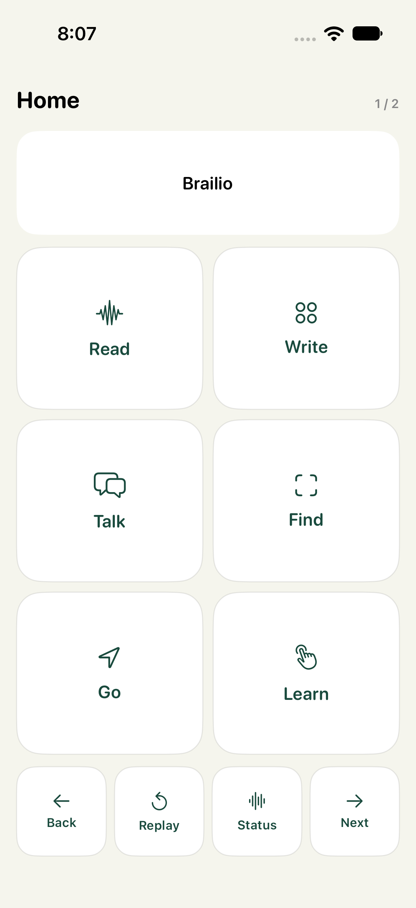
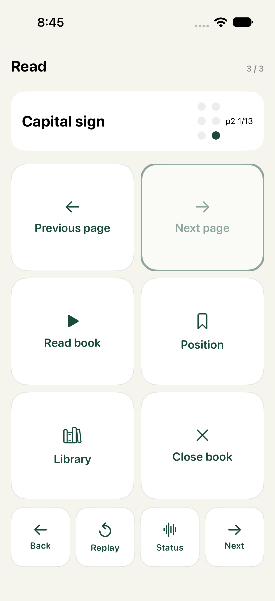
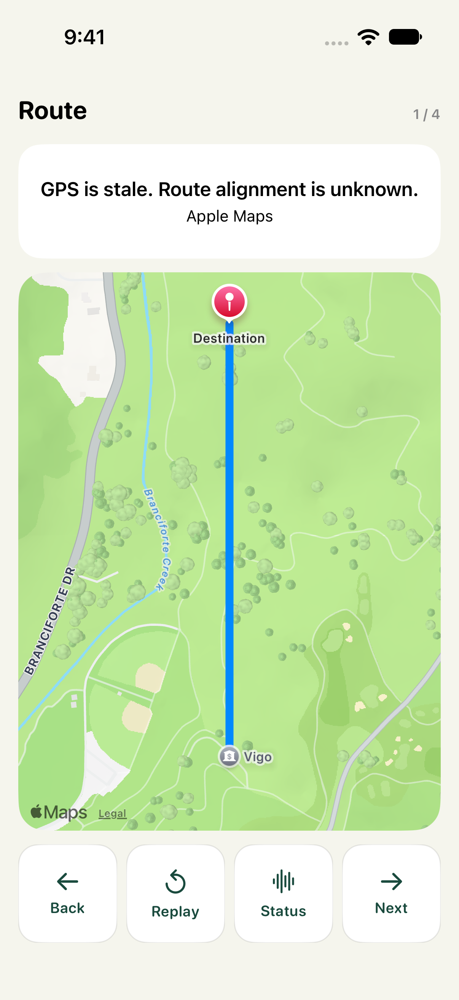
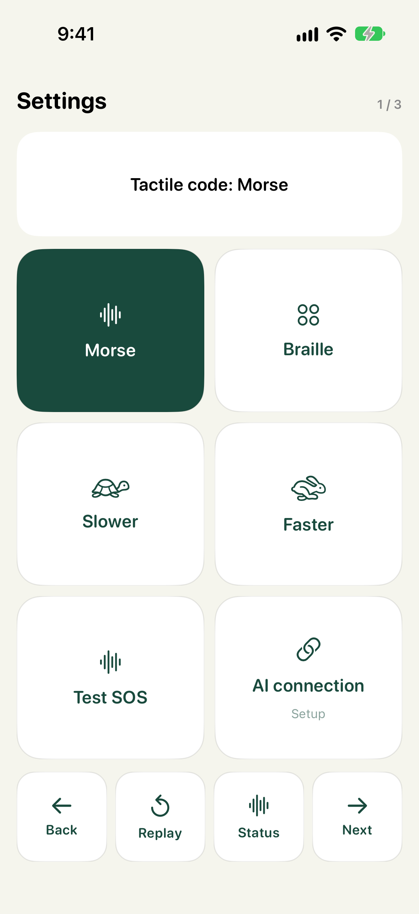
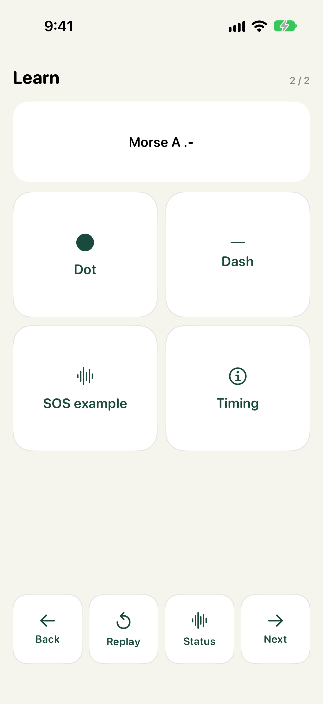
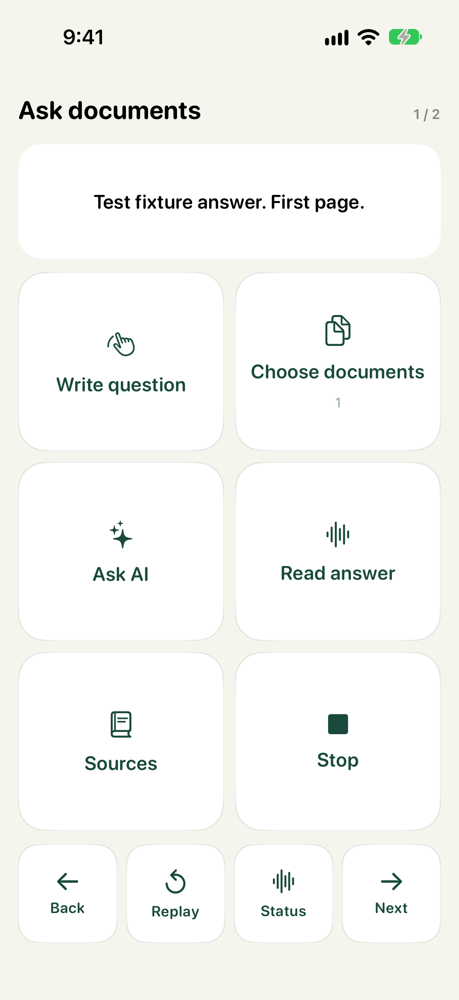

# Brailio

**Read, write, talk, find things and explore routes—through touch.**

Brailio is a native iPhone app designed for DeafBlind and nonspeaking people. It brings everyday tools into one tactile interface: feel a control's label, write with a finger, read text through Morse or Braille vibration patterns, find an object and follow walking-route cues.

[Watch the demo](https://youtu.be/rZSWxz13-gI) · [Devpost](https://devpost.com/software/brailio) · [Design research](docs/UX_RESEARCH.md)

## See the app

| Home | Document reader | Apple Maps route |
| :---: | :---: | :---: |
|  |  |  |

Demo screenshots show the interface; the tactile experience requires a physical iPhone. More examples are in [screenshots](screenshots).

## How touch works

1. **Touch and hold** a control, or slide your finger across the screen, to focus it and feel its label.
2. **Lift, then double-tap** to open the focused action.
3. Use the fixed **Back, Replay, Status and Next** controls. Next moves between pages without scrolling.

App menus use six fixed action zones, so their positions stay predictable. Handwriting, room scanning and map exploration have dedicated touch surfaces. Apple's Files picker and permission dialogs retain system controls. Text, large icons, dark mode, Dynamic Type and VoiceOver also support companions and people with residual vision.

### Choose Morse or Braille

**Morse is the default.** Open **Settings → Morse / Braille** to switch at any time. The choice is saved on the iPhone and applies to text reading, menu labels, handwriting read-back, messages and document playback. Navigation, proximity and Braille-keyboard dot cues keep their own distinct patterns.

Morse uses **short dots and long dashes**. A dot lasts one beat; a dash lasts three. Gaps last one beat inside a character, three between letters and seven between words, following [International Morse code timing](https://www.itu.int/rec/R-REC-M.1677). For example, **a** is `.-`, **b** is `-...`, and **SOS** is `... --- ...`.

In **Learn**, try individual letters, Dot, Dash and the SOS example. **Settings → Test SOS** plays the selected code. Slower/Faster changes the timing; Stronger/Softer is on the next Settings page. Morse does not distinguish capital and lowercase letters. Both modes require learning; neither is assumed to be easier for every user.

Switching codes preserves a document's page but restarts its character position, since Morse and Braille use different character sequences.

| Choose your code | Practice Morse |
| :---: | :---: |
|  |  |

### Braille mode

A normal Braille character has six possible raised dots. Brailio plays those positions **one after another** as six timed slots: a pulse for a raised dot and a quiet slot for an empty dot, followed by a gap between characters. For example, **a** pulses in slot 1; **b** pulses in slots 1 and 2.

This is a learned tactile code played through the phone's haptic engine. It does not create physical dots under the finger. Learn introduces the selected code, and Replay repeats a label or reading.

## What you can do

| Feature | How it works |
| --- | --- |
| **Write** | Draw a whole print word with your finger. Pause to preview and feel the recognition; Space commits a word, and Done finishes. A six-dot Braille writer is also available. |
| **Writing assistant** | Request spelling corrections or a continuation, review the suggestion through tactile playback, and choose whether to accept it. |
| **Read** | Import a PDF or text file, open a direct HTTPS document link, or search imported titles and Internet Archive's public PDF catalog. Read page by page or continue through a book, with a saved reading position. |
| **Talk** | Write a reply and show it full-screen or speak it aloud. A conversation partner's speech can be transcribed for tactile reading. |
| **Find** | Hold the center control to scan, release, then write an object's name. AI identifies it in a current camera snapshot or scan snapshots; ARKit estimates its position, and approach taps get stronger and faster nearby. |
| **Go** | Write a destination and choose Done. Brailio resolves the place, calculates an Apple Maps walking route and starts its tactile map and guidance. Ambiguous destinations require a choice. |
| **Saved** | Find notes, places, object names with last-seen information, and imported documents together on the iPhone. |
| **Learn** | Practice Morse or Braille and the tactile interaction patterns before using the other tools. |

### Finding an object

The finder adapts the spatial flow from [Faith](https://github.com/7dracoder/Faith). It keeps AR tracking active while a name is entered and checks a fresh camera frame first. The selected AI provider returns the object's image bounding box. Baseten is the default. Brailio uses available LiDAR depth, or a ray from the captured camera pose through the object's base to a detected or estimated surface, to establish an approximate 3D position.

No room movie is saved. Temporary still snapshots support the search. During guidance the camera and motion sensors still run for AR tracking; repeated AI inference is not needed to approach a position already measured in that session. Facing away or losing reliable tracking produces a separate double-tap cue.

A tap checks whether the phone is near the measured position. It does **not** prove that the item is correct; the user confirms the actual object. Positions belong to their camera session, can drift and do not follow moved objects. Saved last-seen information helps a later search, rather than guaranteeing an exact persistent indoor location. Mark center provides a manual surface-position option.

### Ask your documents

1. Open **Read → Documents → Phone Files** and select one or several PDFs/text files in the same import.
2. Choose **Ask documents → Choose documents**. Select up to ten imported files. You can also open a book and use **Ask this book** on the final reader page.
3. Choose **Write question**, write with your finger, then choose **Done**. This starts the question automatically. Companion typing and a separate Ask AI control are also available.
4. Feel the answer in your selected **Morse or Braille** code. Use **Read answer** to replay it, **Stop** to cancel, or **Save answer** to keep it as a note.
5. Open **Sources** to feel each cited document's title, page and original passage.

For example: import a schedule and budget, then write “When does the workshop start and what is its budget?”



*Question interface captured with a synthetic UI-test answer; live Baseten transport is tested separately on the iPhone.*

Brailio scans the selected files locally, using OCR for scanned PDF pages. It ranks text passages against the question and sends up to twelve excerpts with their document titles and page numbers to the selected provider. It does not send the whole library automatically. Questions support up to **ten documents, 600 total pages and two million extracted characters**, with a **1000-character question** limit. Large selections must be narrowed rather than silently truncated. Plain-text “pages” are 2400-character sections.

Answers are generated from retrieved excerpts, which may omit relevant passages. Missing evidence produces an explicit “could not find” response. Citation IDs are checked against the submitted passages; this verifies source references, not factual correctness. Conflicting or incomplete evidence and OCR errors can still produce a wrong answer, so review Sources. Stop, leaving the question screen, or backgrounding cancels an in-progress question. Answers remain in memory unless saved as a note.

### Following a route

Apple Maps is the default; no Google Maps key is needed. Hold and slide over the map to feel route-instruction points, then double-tap to open their controls.

- **Approaching:** short pulses grow stronger and faster as the remaining route gets shorter.
- **Wrong turn or sustained deviation:** longer correction pulses, easing as alignment improves.
- **Uncertain location or direction:** two short pulses.
- **Optional silent alignment:** available in route controls.

Guidance runs in the foreground. Approach feedback continues at the final coordinate until Stop; proximity to that coordinate does not establish a safe entrance or crossing. Brailio supplements the user's usual mobility aid.

## Try it on an iPhone

You need a Mac with Xcode, an iPhone running **iOS 17 or later**, and an Apple signing team. Use a physical phone to feel haptics; the Simulator is useful for inspecting screens.

1. Clone this repository and open **Brailio.xcodeproj** in Xcode.
2. Select the **Brailio** target, choose your signing team, connect the iPhone and run.
3. Start with **Learn** to practice the touch controls and Braille patterns.
4. For AI features, open **Settings → AI connection**, keep **Baseten** selected, enter your own Baseten API key and choose **Save and test**. The key stays in that phone's Keychain.
5. Try **Write**, then **Read**, **Talk**, **Find** or **Go**. Allow camera, location, microphone or speech access when the relevant feature needs it.

Handwriting, document OCR, Morse/Braille playback and local storage do not require an AI key. AI requests and online document/place searches need an internet connection. Baseten uses `zai-org/GLM-5.3-Flash` through its Model API. A real optional Gemini connection is available in AI connection with its own separate Keychain credential; it is used only when explicitly selected and configured. See [DemoBaseten.swift](Brailio/Core/DemoBaseten.swift) and [DemoGemini.swift](Brailio/Core/DemoGemini.swift).

An alternative private-device provisioning helper is [scripts/provision-private-demo.sh](scripts/provision-private-demo.sh). It reads the key with terminal echo disabled; close and reopen the app after provisioning to clear the transient launch environment.

## Built with

| Technology | Role |
| --- | --- |
| **SwiftUI / UIKit** | Native iPhone screens and direct-touch interaction |
| **Core Haptics** | Timed Morse/Braille characters and guidance pulses |
| **PencilKit / Vision** | On-device ink capture, handwriting recognition and OCR |
| **ARKit** | Camera tracking, plane estimation, raycasting and supported-device LiDAR depth |
| **MapKit / Core Location** | Apple place search, walking routes and location feedback |
| **PDFKit** | PDF import and page-based reading |
| **Apple Speech / speech synthesis** | Optional conversation transcription and spoken replies |
| **Baseten Model API** | Default provider for document answers, writing assistance and object detection |
| **Gemini API** | Optional direct provider, used only when selected and configured |
| **Node.js / Vercel** | Optional authenticated API backend and public privacy/terms pages |

The backend lives in [backend](backend). Copy its [.env.example](backend/.env.example) into a local environment file and supply your own credentials. Server mode uses an app access token; provider credentials stay on the server. Optional Google Routes support requires a separately configured server key.

## Privacy and current limits

Notes, imported documents and saved items are stored locally. Handwriting and OCR run on device. AI actions send the selected text or camera snapshots to the configured provider; Apple Speech may process partner audio online. Saving an item alone does not upload it. Camera and microphone work stops when leaving the relevant flow or backgrounding. No usable provider key is bundled in the repository.

Brailio is an experimental prototype that needs testing with DeafBlind users and orientation-and-mobility specialists. Its English Braille teaching code covers letters, numbers and common punctuation; full UEB contractions, multilingual text, equations and complex layouts remain future work. Handwriting, OCR, AI detections, AR positions and GPS can be wrong. A base iPhone does not gain LiDAR through this app.

PDF/text imports support files up to 40 MB. Scanned PDF pages use local OCR; bookmarks persist. Online search covers the supported public catalog, not every document on the web. Phone documents are selected through Apple's Files picker rather than silently searched across other apps.

## For developers

```sh
# iOS unit and UI tests (choose an installed Simulator)
xcodebuild -project Brailio.xcodeproj -scheme Brailio \
  -destination 'platform=iOS Simulator,name=iPhone 17' test

# Backend tests
node --test backend/tests/assist.test.js backend/tests/route.test.js
```

Tests cover Morse mappings, dot/dash timing, letter/word gaps, mode persistence, playback completion/cancellation, Braille translation, writing, documents, route feedback, spatial placement, provider responses and fixed UI flows. Simulator and synthetic tests cannot establish real-room positioning accuracy or outdoor safety. The physical-device Morse test requires a connected iPhone; the Simulator cannot verify how vibration feels.

On 25 October 2026, the connected iPhone passed live Baseten questions against one synthetic source and two locally imported synthetic documents, with valid citations, followed by tactile playback. The physical Morse SOS haptic test also passed. These checks confirm transport, response handling and hardware playback without establishing real-user comprehension. Simulator UI tests use an explicit synthetic response fixture rather than a live model.

Project configuration is in [project.yml](project.yml); use `xcodegen generate` after changing that configuration. Research sources and design boundaries are in [docs/UX_RESEARCH.md](docs/UX_RESEARCH.md).

## What's next

Co-design and supervised usability testing with DeafBlind users; richer Braille language support; refreshable Braille display integration; stronger indoor relocalization; and per-user authentication and quotas for a wider release.

Inspired by [VibroBraille](https://devpost.com/software/vibrobraille-pc-to-braille-ai-relay), with the object-positioning approach adapted from [Faith](https://github.com/7dracoder/Faith).
